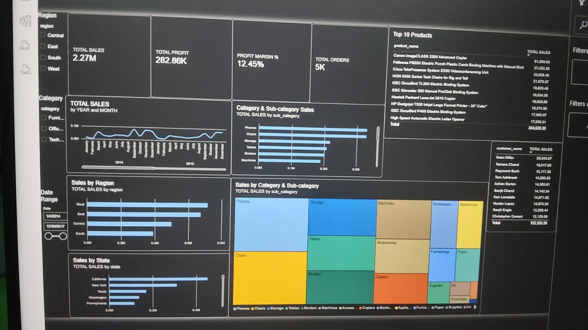
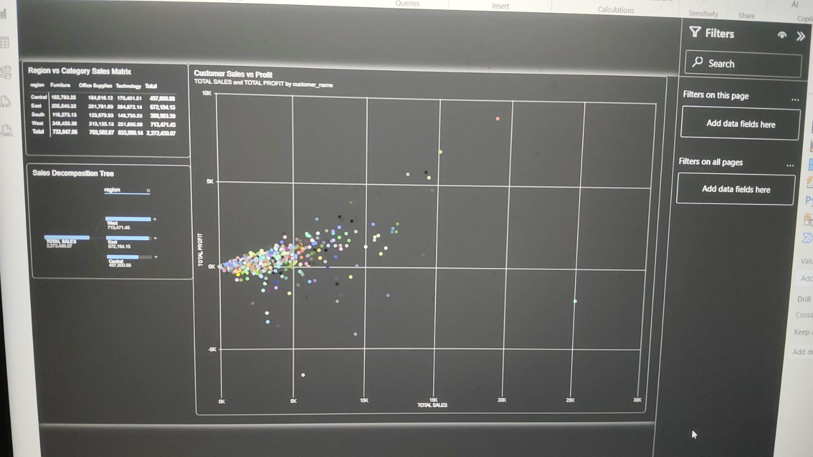
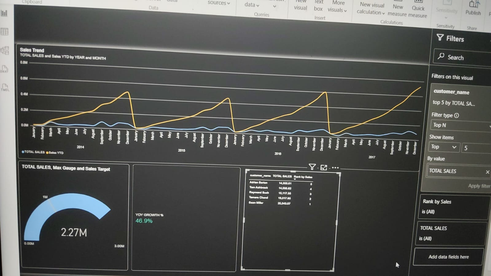
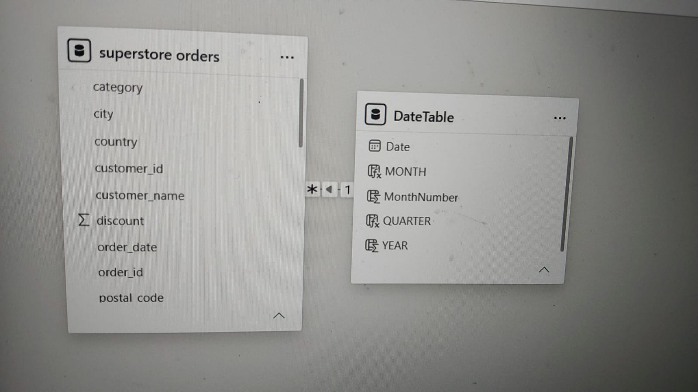

# Retail Superstore Sales Dashboard

**Power BI · MySQL · DAX · Star-schema modeling**

A 3-page dashboard that turns order-level retail data (2014–2017, about 5,000 order records) into KPIs, customer analysis and time-intelligence views.

## Key Findings
- Year-over-year sales growth of **46.9%**.
- 2016 had the strongest cumulative (YTD) sales of the years analyzed.
- A small group of top customers contributes a large share of revenue, which is a customer-concentration risk.
- Monthly sales are stable, so there is room for seasonal promotions.

## Data Model & DAX
- Source: MySQL `superstore` database, connected live to Power BI.
- `DateTable` linked one-to-many to `orders[order_date]` (star schema).
- Measures: `TOTALYTD`, `SAMEPERIODLASTYEAR`, `RANKX`, profit margin, and a Sales vs Target gauge.

## Dashboard Preview
**Page 1: Overview**

**Page 2: Customer & Product Deep-Dive**

**Page 3: Time Intelligence & Insights**

**Data model**

## Files
- `PowerBI/Superstore_Dashboard.pbix`: the dashboard
- `Report/Sales_Retail_Report_Karan_Bisht.docx`: full project report
