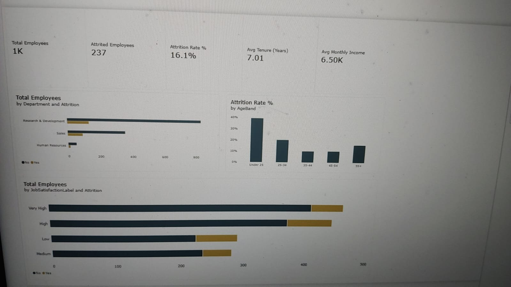
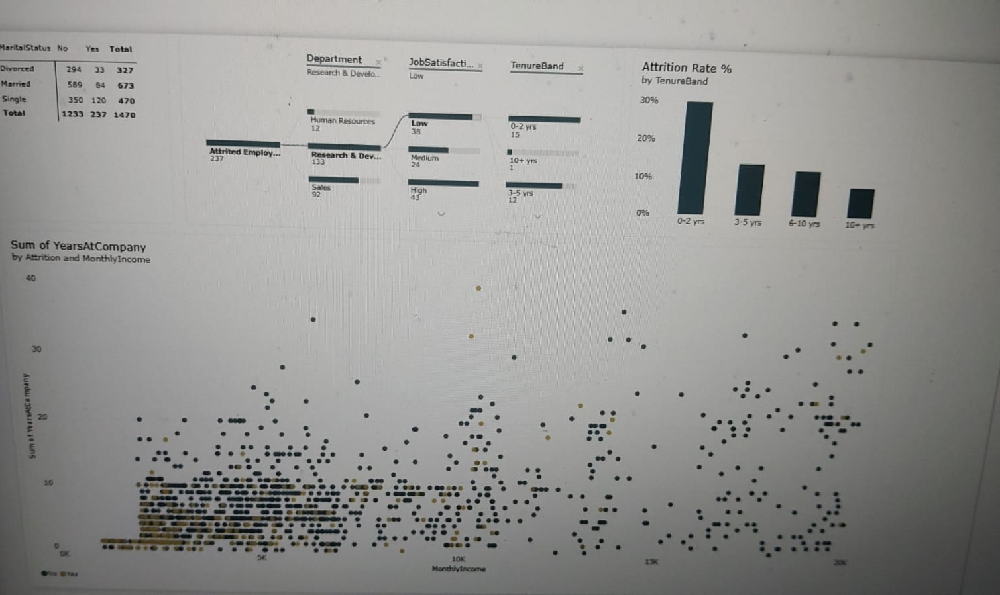
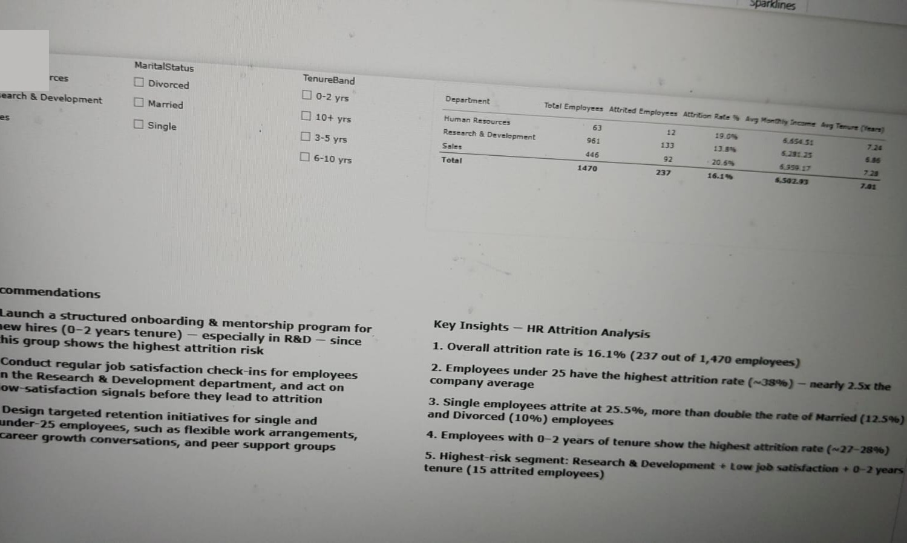

# HR Attrition Analytics Dashboard

**Power BI · DAX · Decomposition Tree**

An interactive dashboard on the IBM HR Analytics attrition dataset (1,470 employees) that shows where attrition is concentrated and what factors go with it.

## Key Findings
| Department | Employees | Attrited | Attrition % |
|---|---|---|---|
| Sales | 446 | 92 | 20.6% |
| Human Resources | 63 | 12 | 19.0% |
| Research & Development | 961 | 133 | 13.8% |
| **Total** | **1,470** | **237** | **16.1%** |

- Employees under 25 leave at **39.2%**, about 2.4× the company average.
- Single employees leave at roughly double the rate of married employees.
- Employees with 0–2 years of tenure leave at 2.5–3× the rate of those with 6+ years.
- Highest-risk segment found with the decomposition tree: R&D, low job satisfaction, 0–2 years tenure.

## Dashboard Preview
**Page 1: Overview**

**Page 2: Deep-Dive & Drivers**

**Page 3: Summary & Recommendations**

## Files
- `Dataset/IBM.csv`: source data (1,470 rows, 13 columns)
- `PowerBI/HR_Dashboard.pbix`: the dashboard
- `Report/HR_Report_Karan_Bisht.docx`: full project report
