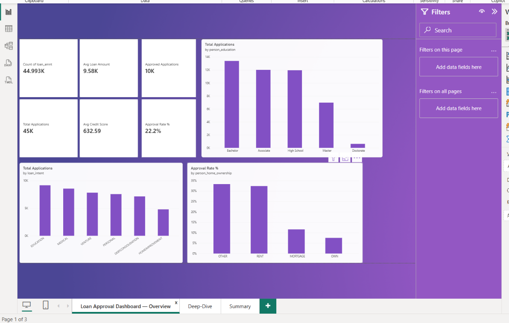
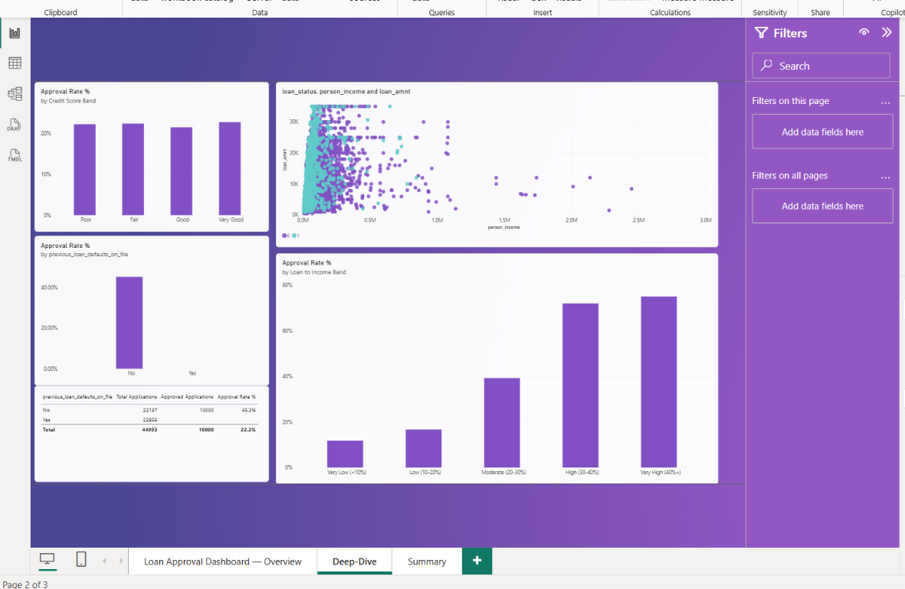
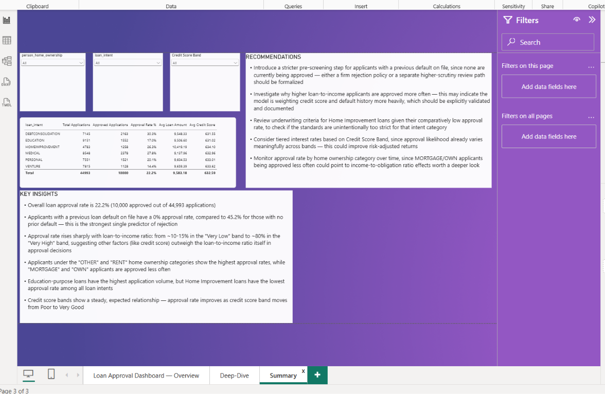

# Loan Approval & Risk Analysis Dashboard

**Power BI · DAX · Finance analytics**

A 3-page dashboard on 44,993 loan applications (after removing 7 invalid or duplicate rows) that explains what drives approval and rejection.

## Key Findings
- Only **22.2%** of applications were approved (10,000 of 44,993).
- Applicants with a previous loan default were approved **0%** of the time, vs **45.2%** with a clean history.
- Approval rises steadily with credit score band.
- Education loans have the most applications, while Home Improvement loans have the lowest approval rate.
- Approval rate rises with loan-to-income ratio, which is unusual and worth investigating.
- Average credit score is 632.59 ("Fair" range).

## Dashboard Preview
**Page 1: Overview**

**Page 2: Deep-Dive & Drivers**

**Page 3: Summary & Recommendations**

## Files
- `Dataset/loan_data.csv`: Kaggle "Loan Approval Classification Dataset" (author: taweilo)
- `PowerBI/Finance_Dashboard.pbix`: the dashboard
- `Report/Finance_Report_Karan_Bisht.docx`: full project report
