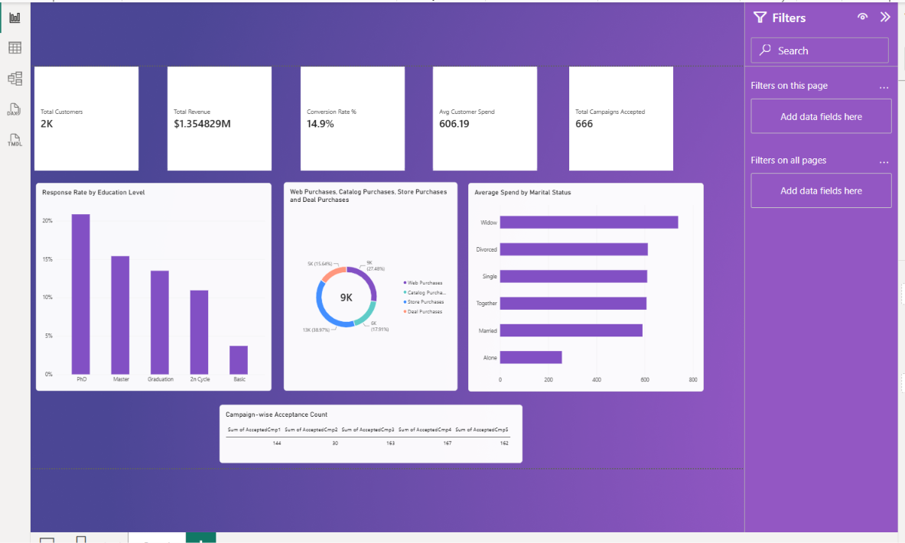
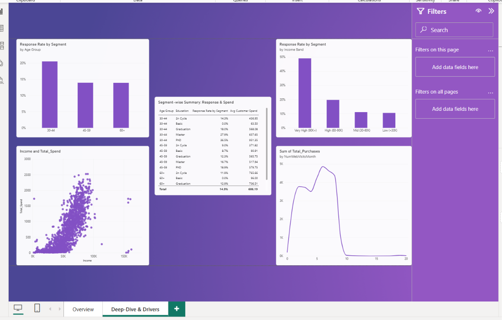
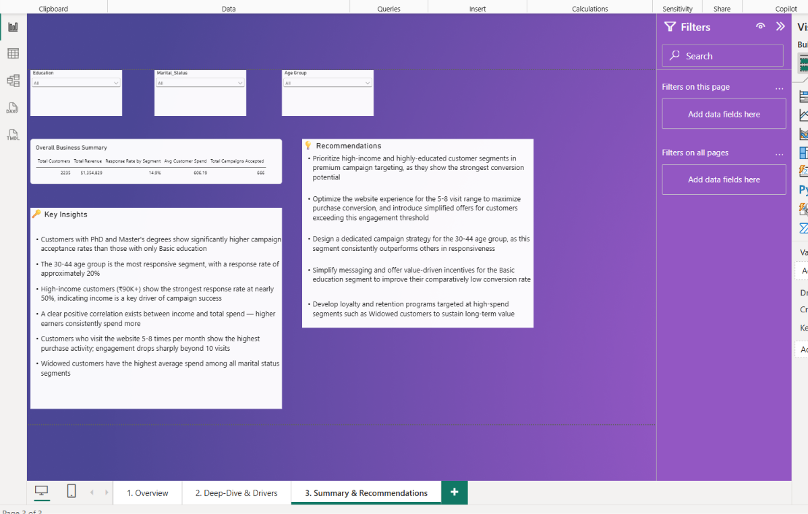

# Marketing Campaign Performance & Customer Analytics Dashboard

**Power BI · DAX · Power Query**

A 3-page dashboard on 2,240 customer records and six marketing campaigns, built to show who responds to campaigns and why.

## Key Findings
- Education predicts response: PhD (20.9%) and Master's (15.4%) vs Basic (3.7%).
- The 30–44 age group is the most responsive (20.5%).
- Income is the strongest driver: response rises from **10.5%** (low income) to **49.1%** (very high income).
- Website visits have a sweet spot at 5–8 per month, and purchases drop sharply beyond 10.
- Campaigns 4 and 5 performed best (167 and 162 acceptances). Campaign 2 underperformed (30).

## Dashboard Preview
**Page 1: Overview**

**Page 2: Deep-Dive & Drivers**

**Page 3: Summary & Recommendations**

## Files
- `Dataset/marketing_campaign.csv`: Kaggle Marketing Campaign dataset
- `PowerBI/Marketing_Dashboard.pbix`: the dashboard
- `Report/Marketing_Report_Karan_Bisht.docx`: full project report
